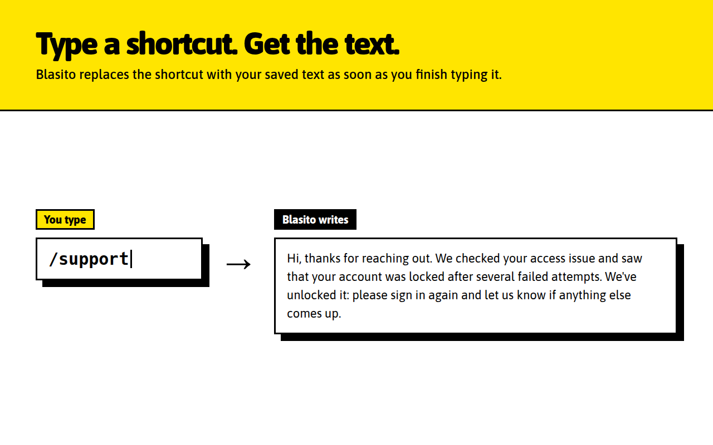
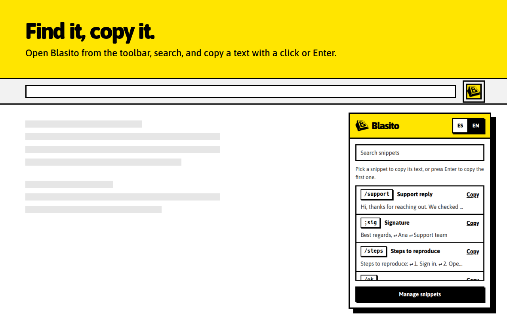
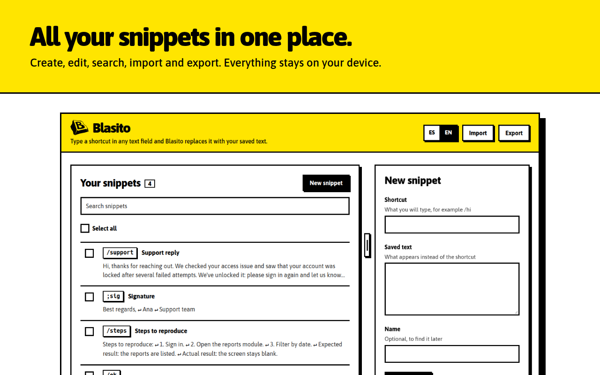

<div align="center">
  <picture>
    <source media="(prefers-color-scheme: dark)" srcset="src/shared/logo-white.svg" />
    
  </picture>
  <h1>Blasito</h1>
  <p><strong>A local-first text expander for Chromium.</strong><br />
  Type a shortcut like <code>/hi</code> in any text field and Blasito replaces it with the text you saved.<br />
  No accounts, no servers, no tracking.</p>
  <p>
    <a href="#install">Install</a> ·
    <a href="#usage">Usage</a> ·
    <a href="#privacy">Privacy</a> ·
    <a href="#development">Development</a>
  </p>
</div>



## Features

- **Expands as you type** in `input`, `textarea` and rich editors (`contenteditable`). It never touches password or other non-text fields.
- **Popup search:** find a snippet from the toolbar and copy it with a click, or type and press Enter to copy the first result.
- **Manage snippets** in a list with an editor next to it: create, edit, search, select several and delete.
- **Import and export** your snippets as JSON.
- **Safe by default:** asks before deleting or discarding unsaved changes, and warns when a shortcut is a plain word (like `ok`) that would also expand inside normal sentences.
- **English and Spanish:** switch with the **ES / EN** control in the header. The first time, Blasito follows the browser's language.
- **Keyboard friendly and accessible:** ↑/↓ through the list, Esc to leave the editor, a resizable editor, text contrast of at least 7:1, visible focus and no motion when the system asks for reduced motion.

| Popup | Options page |
| --- | --- |
|  |  |

> **About the translation:** Blasito was written in Spanish. The English version is new and may contain mistakes; corrections are welcome.

## Install

**Chrome Web Store:** coming soon.

**From source** (Node.js 22.12 or newer):

```bash
git clone https://github.com/gabialonso/blasito.git
cd blasito
npm install
npm run build
```

Then open `chrome://extensions`, turn on **Developer mode**, choose **Load unpacked** and select the `dist/` folder.

## Usage

1. Click the Blasito icon and choose **Manage snippets**.
2. Press **New snippet**, write a shortcut (for example `/hi`) and the text it should become, then **Save snippet**.
3. Type `/hi` in any text field. As soon as you finish the shortcut, Blasito replaces it and leaves the cursor at the end.

Start shortcuts with a symbol such as `/` or `;`, so they never match normal words.

### Keyboard (options page)

| Key | Action |
| --- | --- |
| Tab (first) | Shows **Skip to editor** |
| ↑ / ↓ from the search | Move through the snippets; Enter opens one |
| Esc in the editor | Stop editing (asks first if there are unsaved changes) |
| ← / → on the divider | Make the editor wider or narrower |

### Import format

A JSON array, or the same array inside a `snippets` property. `shortcut` and `content` are required; `name` is optional. Files made with **Export** can be imported back. Duplicates and invalid entries are skipped and reported; if the file is not valid, nothing changes.

```json
[
  { "name": "Greeting", "shortcut": "/hi", "content": "Hi, how are you?" },
  { "shortcut": ";sig", "content": "Best regards." }
]
```

## Privacy

Everything stays on your device in `chrome.storage.local`. Blasito makes no network requests and only asks for the `storage` permission. See [PRIVACY.md](PRIVACY.md) for the details.

## Development

```bash
npm run typecheck   # TypeScript checks
npm test            # unit tests (Vitest)
npm run build       # build into dist/
npm run package     # build and create blasito.zip for the Chrome Web Store
```

The stack is TypeScript and Vite, with no UI framework: each screen is an HTML page plus a script that builds the list with DOM functions.

```text
public/                manifest.json, icons and the store summary in each language (_locales/)
src/
  snippets/            logic with no Chrome or DOM: validate, search, import, expand
  content/             content script that runs in web pages
  options/             options page and its resizable divider
  popup/               search and quick copy
  shared/              texts in each language (i18n.ts), DOM helpers, styles, fonts and logo
tests/                 same folders as src/
store/                 Chrome Web Store images (icon, and en/ and es/ screenshots)
docs/                  publishing notes
```

### How a shortcut flows

1. On the options page, `options/index.ts` calls `snippets/storage.ts`, which validates with `snippets/model.ts` and saves the list to `chrome.storage.local`.
2. `content/index.ts` loads the list when a page opens and gets every change through `watchSnippets`.
3. On each keystroke it drops unsupported fields, then `mightCompleteShortcut` skips any character that cannot end a shortcut. Only then does `content/expand.ts` look for the shortcut before the cursor and replace it.

Anything in `src/snippets/` runs without Chrome, so start there (and in `tests/snippets/`) when changing behavior.

### Texts and languages

Every interface text lives in `src/shared/i18n.ts`, once in Spanish and once in English; TypeScript fails if a key is missing in one of them. Static texts are marked in the HTML with `data-i18n` (or `data-i18n-placeholder`, `-label`, `-title`), and scripts call `t()`. The chosen language is saved in the extension's `localStorage`, so the popup and the options page stay in sync.

### Style

The design is brutalist and light-only for now. Colors, fonts, borders, shadows, spacing and animation speeds are variables at the top of `src/shared/styles.css`. Rows are inverted by swapping the `--bg` and `--ink` roles. The logo is in `src/shared/`, in black (`logo.svg`) and white (`logo-white.svg`).

## Contributing

Issues and pull requests are welcome, including fixes to the English or Spanish texts.

- `main` holds released versions only. Work happens on `develop`.
- Branch off `develop` with a descriptive name (`feat/…`, `fix/…`, `docs/…`) and open the pull request against `develop`.
- Commits follow [Conventional Commits](https://www.conventionalcommits.org/), one line in English.
- Before opening a pull request, run `npm run typecheck && npm test && npm run build`, and add a test when you change something in `src/snippets/` or `src/content/`.

Keep it simple: prefer what the browser already does over new code or dependencies.

## Credits

- [Asap](https://github.com/Omnibus-Type/Asap) by Omnibus-Type, SIL Open Font License 1.1.
- [Hack](https://github.com/source-foundry/Hack) by Source Foundry, MIT License and Bitstream Vera License.

The fonts and their licenses are in `src/shared/fonts/` and are included in the packaged extension.

## License

[MIT](LICENSE) © 2026 Gabriel Alonso
